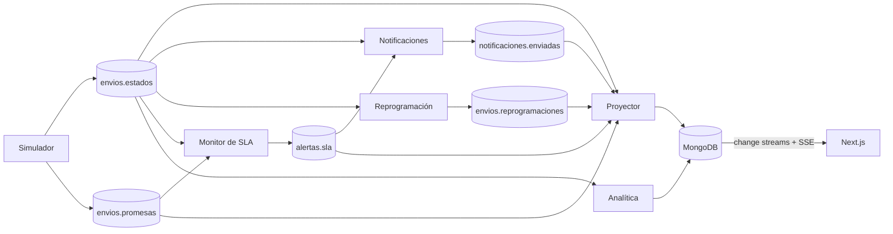

# RutaSur

Plataforma de seguimiento de envíos en tiempo real para un operador de última milla ficticio, de punta a punta: desde la generación de eventos hasta el tablero del supervisor. Si cada cambio de estado se trata como un evento, la empresa puede intervenir durante la operación en lugar de analizar fracasos al día siguiente.

**Stack:** Apache Kafka, Node.js, MongoDB y Next.js, en local con Docker Compose.

## Cómo levantarlo

Requiere Docker con Docker Compose. Antes, liberá los puertos 3000, 4000, 8080, 9092 y 27017.

```bash
docker compose up --build
```

| Pantalla | URL | Usuario |
|----------|-----|---------|
| Torre de control | http://localhost:3000 | Supervisor |
| Detalle del envío | http://localhost:3000/envios/{id} | Supervisor |
| Tracking público | http://localhost:3000/tracking/{id} | Destinatario |
| Analítica | http://localhost:3000/analitica | Gerencia |
| Panel de demo | http://localhost:3000/demo | Quien presenta |
| Kafka UI | http://localhost:8080 | Grupos, lag y DLQ |

## Arquitectura

Kafka es el único punto de contacto entre los servicios: ninguno llama a otro en forma directa. MongoDB guarda vistas derivadas y Next.js solo lee de ahí.



| Servicio | Responsabilidad | Grupo |
|----------|-----------------|-------|
| `simulador` | Genera envíos, promesas y cambios de estado | No consume |
| `proyector` | Mantiene `envios`, `alertas` y `notificaciones` | `proyector` |
| `notificaciones` | Registra avisos ante fallos y alertas | `notificaciones` |
| `reprogramacion` | Decide el próximo intento tras una entrega fallida | `reprogramacion` |
| `monitor-sla` | Detecta envíos en riesgo y emite alertas | `monitor-sla` |
| `analitica` | Actualiza `metricas_diarias` | `analitica` |
| `analitica-hub` | Cuarto indicador, para mostrar el reprocesamiento | `analitica-tiempo-hub` |

## Simulador

Corre con semilla fija: la misma semilla repite la misma corrida. Una hora simulada son 30 segundos reales.

| Parámetro | Valor |
|-----------|-------|
| Envíos por minuto | 20 |
| Tasa de fallo por zona | De 5% a 30% |
| Motivos | 60% ausente, 20% dirección, 15% rechazo, 5% zona |
| Demora en hub | 10% |
| Duplicados y fuera de orden | 2% cada uno |
| Malformados | 1% |

## Pruebas

```bash
npm install
npm test
```

Con el entorno levantado, esta prueba recorre los criterios de aceptación (tarda varios minutos, y detiene y reinicia servicios durante la corrida):

```bash
npm run test:e2e
```

## Documentación

- [Guion de la demo](docs/guion-demo.md)
- [Decisiones de diseño](docs/decisiones.md)
